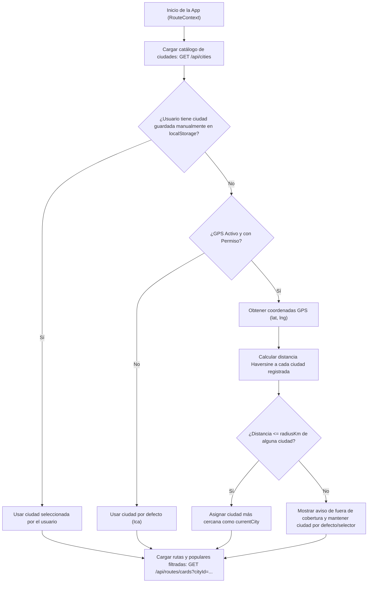

# Plan de Implementación: Detección y Filtrado de Rutas por Ciudad (GPS + Selector Manual)

> **Proyecto:** RutaYa  
> **Estrategia Seleccionada:** Opción 1 — Coordenadas centrales y radio de cobertura en la entidad `City` (Cálculo geográfico autónomo por distancia Haversine + Selector manual de respaldo).  
> **Estado:** Planificado / Listo para ejecución

---

## 1. Resumen Ejecutivo y Arquitectura

El objetivo de esta implementación es que **RutaYa** muestre dinámicamente las rutas, paraderos, líneas y búsquedas correspondientes a la ciudad donde se encuentra el usuario (por ejemplo, **Ica** o **Lima**), basándose en su ubicación GPS o en su selección manual.

### Flujo de Resolución de Ciudad



---

## 2. Fase 1: Base de Datos (PostgreSQL / PostGIS)

Actualmente la tabla `cities` almacena `id`, `name`, `department` y `country`. Se agregarán tres columnas para definir el punto central de cada ciudad y su radio de cobertura en kilómetros.

### 2.1. Nueva Migración SQL
**Archivo a crear:** `backend/src/main/resources/db/migration/V6__add_coordinates_to_cities.sql`

```sql
-- Migration V6: Add geographic center coordinates and coverage radius to cities table
-- Enables automatic city detection from user GPS coordinates via Haversine distance.

ALTER TABLE cities ADD COLUMN IF NOT EXISTS latitude DECIMAL(10, 7);
ALTER TABLE cities ADD COLUMN IF NOT EXISTS longitude DECIMAL(10, 7);
ALTER TABLE cities ADD COLUMN IF NOT EXISTS radius_km DECIMAL(6, 2) NOT NULL DEFAULT 30.0;

-- Backfill coordinates for existing seeded cities (Lima & Ica)
UPDATE cities
SET latitude = -12.0463740,
    longitude = -77.0427930,
    radius_km = 60.00
WHERE LOWER(name) = 'lima';

UPDATE cities
SET latitude = -14.0677700,
    longitude = -75.7286100,
    radius_km = 30.00
WHERE LOWER(name) = 'ica';
```

### 2.2. Actualización del Seed de Datos
**Archivo a modificar:** `backend/src/main/resources/db/seed/seed_data.sql`

Actualizar el bloque `INSERT INTO cities` para que incluya las coordenadas desde el arranque en entornos de desarrollo/pruebas:

```sql
INSERT INTO cities (id, name, department, country, latitude, longitude, radius_km, created_at, updated_at) VALUES
('10000000-0000-4000-8000-000000000001', 'Lima', 'Lima', 'Perú', -12.0463740, -77.0427930, 60.00, NOW(), NOW()),
('10000000-0000-4000-8000-000000000002', 'Ica',  'Ica',  'Perú', -14.0677700, -75.7286100, 30.00, NOW(), NOW());
```

---

## 3. Fase 2: Backend (Spring Boot / Java)

### 3.1. Entidad `City`
**Archivo a modificar:** `backend/src/main/java/com/anthony/rutas/entities/City.java`

Agregar los campos de coordenadas y radio:

```java
@Column(precision = 10, scale = 7)
private java.math.BigDecimal latitude;

@Column(precision = 10, scale = 7)
private java.math.BigDecimal longitude;

@Column(name = "radius_km", precision = 6, scale = 2, nullable = false)
@Builder.Default
private java.math.BigDecimal radiusKm = java.math.BigDecimal.valueOf(30.0);
```

### 3.2. DTOs de Entrada y Salida

1. **`CreateCityRequest.java`** (`backend/src/main/java/com/anthony/rutas/dtos/request/CreateCityRequest.java`):
   * Agregar `Double latitude`, `Double longitude` y `Double radiusKm` (con valor por defecto `30.0`).
   * Agregar validaciones `@DecimalMin` / `@DecimalMax` opcionales para latitud (`-90` a `90`) y longitud (`-180` a `180`).

2. **`CityResponse.java`** (`backend/src/main/java/com/anthony/rutas/dtos/response/CityResponse.java`):
   ```java
   public class CityResponse {
       private UUID id;
       private String name;
       private String department;
       private String country;
       private Double latitude;
       private Double longitude;
       private Double radiusKm;
   }
   ```

3. **`RouteSummaryResponse.java`** (`backend/src/main/java/com/anthony/rutas/dtos/response/RouteSummaryResponse.java`):
   * Añadir `private UUID cityId;` y `private String cityName;` para que cada tarjeta de ruta conozca explícitamente a qué ciudad pertenece.

4. **`PopularRouteResponse.java`** (`backend/src/main/java/com/anthony/rutas/dtos/response/PopularRouteResponse.java`):
   * Añadir `private UUID cityId;` y `private String cityName;`.

### 3.3. Mapper (`DtoMapper.java`)
**Archivo a modificar:** `backend/src/main/java/com/anthony/rutas/mappers/DtoMapper.java`

* En `toCityResponse(City city)`: mapear `latitude`, `longitude` y `radiusKm` convirtiendo de `BigDecimal` a `Double`.
* En `toRouteSummaryResponse(Route route, ...)`: mapear `cityId` y `cityName` desde `route.getTransportLine().getCity()`.
* En `toPopularRouteResponse(Route route, ...)`: mapear `cityId` y `cityName`.

### 3.4. Repositorio de Rutas (`RouteRepository.java`)
**Archivo a modificar:** `backend/src/main/java/com/anthony/rutas/repositories/RouteRepository.java`

Actualizar y añadir consultas con `JOIN FETCH` a `transportLine` y `city` para evitar el problema de consultas N+1 y permitir filtrar por `cityId`:

```java
// 1. Obtener todas las rutas con su línea y ciudad (sin filtro)
@Query("SELECT DISTINCT r FROM Route r " +
       "JOIN FETCH r.transportLine tl " +
       "JOIN FETCH tl.city")
List<Route> findAllWithTransportLine();

// 2. Obtener todas las rutas filtradas por ciudad
@Query("SELECT DISTINCT r FROM Route r " +
       "JOIN FETCH r.transportLine tl " +
       "JOIN FETCH tl.city c " +
       "WHERE c.id = :cityId")
List<Route> findAllByCityIdWithTransportLine(@Param("cityId") UUID cityId);

// 3. Obtener rutas populares filtradas por ciudad
@Query("SELECT r FROM Route r " +
       "JOIN FETCH r.transportLine tl " +
       "JOIN FETCH tl.city c " +
       "WHERE r.status = 'ACTIVE' AND c.id = :cityId " +
       "ORDER BY COALESCE(r.popularityScore, 0) DESC, r.name ASC")
List<Route> findPopularByCityId(@Param("cityId") UUID cityId, Pageable pageable);

// 4. Búsqueda por texto filtrada por ciudad
@Query("SELECT DISTINCT r FROM Route r " +
       "JOIN FETCH r.transportLine tl " +
       "JOIN FETCH tl.city c " +
       "LEFT JOIN r.directions rd " +
       "LEFT JOIN rd.routeStops rs " +
       "LEFT JOIN rs.stop s " +
       "WHERE c.id = :cityId AND (" +
       "   LOWER(r.name) LIKE LOWER(CONCAT('%', :query, '%')) " +
       "   OR LOWER(r.code) LIKE LOWER(CONCAT('%', :query, '%')) " +
       "   OR LOWER(tl.name) LIKE LOWER(CONCAT('%', :query, '%')) " +
       "   OR LOWER(s.name) LIKE LOWER(CONCAT('%', :query, '%')) " +
       "   OR LOWER(s.reference) LIKE LOWER(CONCAT('%', :query, '%'))" +
       ")")
List<Route> searchByQueryAndCityId(@Param("query") String query, @Param("cityId") UUID cityId);
```

### 3.5. Servicios (`CityService.java` y `RouteService.java`)

1. **`CityService.java`**:
   * En `create` y `update`: guardar `latitude`, `longitude` y `radiusKm` en la entidad `City`.

2. **`RouteService.java`**:
   * Sobrecargar o parametrizar `findAllCards(UUID cityId)`:
     * Si `cityId != null`, llama a `routeRepository.findAllByCityIdWithTransportLine(cityId)`.
     * Si `cityId == null`, llama a `routeRepository.findAllWithTransportLine()`.
   * Parametrizar `findPopularRoutes(UUID cityId)`:
     * Si `cityId != null`, llama a `routeRepository.findPopularByCityId(cityId, PageRequest.of(0, MAX_POPULAR_ROUTES))`.
   * Parametrizar `search(String query, UUID cityId)`:
     * Si `cityId != null`, llama a `routeRepository.searchByQueryAndCityId(query, cityId)`.

### 3.6. Controlador (`RouteController.java`)
**Archivo a modificar:** `backend/src/main/java/com/anthony/rutas/controllers/RouteController.java`

Agregar `@RequestParam(required = false) UUID cityId` a los endpoints públicos para mantener retrocompatibilidad total:

| Endpoint | Parámetros Query | Descripción |
| :--- | :--- | :--- |
| `GET /api/routes/cards` | `?cityId={uuid}` *(opcional)* | Devuelve las tarjetas de rutas de esa ciudad. |
| `GET /api/routes/popular` | `?cityId={uuid}` *(opcional)* | Devuelve el top 10 de rutas populares de esa ciudad. |
| `GET /api/routes/search` | `?query={texto}&cityId={uuid}` *(opcional)* | Busca rutas o paraderos solo dentro de esa ciudad. |

---

## 4. Fase 3: Frontend (React / Vite)

### 4.1. Utilidad de Detección Geográfica (`geoUtils.js`)
**Archivo a modificar:** `frontend/src/utils/geoUtils.js`

Agregar una función pura que reciba las coordenadas del usuario y la lista de ciudades del backend, y determine en qué ciudad se encuentra:

```javascript
/**
 * Determina la ciudad más cercana dentro de su radio de cobertura.
 * @param {number} userLat - Latitud del usuario
 * @param {number} userLng - Longitud del usuario
 * @param {Array} cities - Lista de ciudades con { id, name, latitude, longitude, radiusKm }
 * @returns {{ city: Object|null, nearestCity: Object|null, distanceKm: number, isInsideCoverage: boolean }}
 */
export function detectCityFromCoords(userLat, userLng, cities) {
  if (userLat == null || userLng == null || !Array.isArray(cities) || cities.length === 0) {
    return { city: null, nearestCity: null, distanceKm: Infinity, isInsideCoverage: false };
  }

  let nearestCity = null;
  let minDistance = Infinity;

  for (const city of cities) {
    if (city.latitude == null || city.longitude == null) continue;
    const dist = calculateDistanceKm(userLat, userLng, Number(city.latitude), Number(city.longitude));
    if (dist < minDistance) {
      minDistance = dist;
      nearestCity = city;
    }
  }

  if (!nearestCity) {
    return { city: null, nearestCity: null, distanceKm: Infinity, isInsideCoverage: false };
  }

  const maxRadius = Number(nearestCity.radiusKm) || 30;
  const isInside = minDistance <= maxRadius;

  return {
    city: isInside ? nearestCity : null,
    nearestCity,
    distanceKm: minDistance,
    isInsideCoverage: isInside,
  };
}
```

### 4.2. Servicios Frontend (`routeService.js` y `geocodingService.js`)

1. **`frontend/src/services/routeService.js`**:
   * Actualizar `getAllRoutes(cityId)` para enviar `params: cityId ? { cityId } : {}`.
   * Actualizar `getPopularRoutes(cityId)` para enviar `params: cityId ? { cityId } : {}`.
   * Actualizar `searchRoutes(query, cityId)` para enviar `params: { query, ...(cityId ? { cityId } : {}) }`.

2. **`frontend/src/services/geocodingService.js`**:
   * Eliminar el uso fijo de `ICA_LAT` e `ICA_LON` como única referencia.
   * Modificar `searchPlace(query, centerCoords)` para que reciba las coordenadas de la ciudad activa (`currentCity.latitude`, `currentCity.longitude`) y priorice resultados de esa ciudad en Photon OSM.
   * En `reverseGeocode(lat, lon)`, evitar forzar `"Ica"` cuando Photon ya trae el nombre de otra ciudad (como `"Lima"`).

3. **`frontend/src/utils/adapters.js`**:
   * En `normalizeRoute(raw)`: incluir `cityId: raw.cityId || null` y `cityName: raw.cityName || ""`.

### 4.3. Estado Global en `RouteContext.jsx`
**Archivo a modificar:** `frontend/src/contexts/RouteContext.jsx`

1. **Nuevos estados en el contexto:**
   * `cities`: Lista de ciudades disponibles cargadas desde `cityService.getAllCities()`.
   * `currentCity`: Objeto de la ciudad activa `{ id, name, latitude, longitude, radiusKm }`.
   * `isManualCity`: Booleano (indica si el usuario eligió manualmente la ciudad para que el GPS no se la cambie bruscamente si está consultando otra ciudad a propósito).
   * `outsideCoverage`: Booleano (indica si el GPS detectó que el usuario está en otra región sin cobertura, ej. Arequipa).

2. **Lógica de inicialización y sincronización:**
   * Al montar la app, se obtiene `cityService.getAllCities()`.
   * Si no hay GPS aún, se selecciona por defecto la ciudad guardada en `localStorage.getItem("rutasya_selected_city_id")` o, en su defecto, `"Ica"`.
   * Cuando `gpsReady` o `hasCustomLocation` pasa a `true` (y el usuario no ha bloqueado manualmente otra ciudad), se ejecuta `detectCityFromCoords(userLocation.lat, userLocation.lng, cities)`:
     * Si detecta una ciudad distinta a la actual (ej. el usuario está en **Lima**), actualiza `currentCity` a **Lima**.
   * Cada vez que `currentCity?.id` cambia, se dispara `loadData(currentCity.id)` que recarga `routes` y `popularRoutes` exclusivamente de esa ciudad.

### 4.4. Interfaz Ciudadana: Selector de Ciudad y Mapa

1. **Header en `HomePage.jsx`** (`frontend/src/pages/citizen/HomePage.jsx`):
   * Reemplazar el texto fijo `<Sparkles /> Ica` de la línea 90 por un botón interactivo que muestre `{currentCity?.name || 'Ica'}` con un ícono `ChevronDown`.
   * Al hacer clic en ese badge, abrir un pequeño menú desplegable o modal ligero donde el usuario pueda alternar entre las ciudades disponibles (**Ica**, **Lima**, etc.) o elegir *"Detectar por GPS"*.

2. **Centrado Dinámico del Mapa (`InteractiveMap.jsx` y `HomeMapPage.jsx`)**:
   * Si el usuario no tiene el GPS encendido y abre el mapa mientras su ciudad activa es **Lima**, el centro inicial del mapa será `[currentCity.latitude, currentCity.longitude]` en lugar de centrarse siempre en la Plaza de Armas de Ica.

### 4.5. Panel de Administración (`AdminDashboardPage.jsx`)
**Archivo a modificar:** `frontend/src/pages/admin/AdminDashboardPage.jsx`

En la pestaña **Ciudades** (`activeTab === 'cities'`):
1. Actualizar `cityForm` inicial para incluir `latitude: ''`, `longitude: ''`, `radiusKm: 30`.
2. Agregar 3 campos al formulario de crear/editar ciudad (`FormPanel`):
   * **Latitud central** (`type="number" step="any"`, ej. `-14.0678`)
   * **Longitud central** (`type="number" step="any"`, ej. `-75.7286`)
   * **Radio de cobertura (km)** (`type="number"`, ej. `30`)
3. Mostrar en la tabla de ciudades registradas una columna adicional con las coordenadas/radio de cobertura.

---

## 5. Manejo de Casos Borde (Edge Cases)

| Escenario | Comportamiento del Sistema |
| :--- | :--- |
| **1. Usuario deniega el permiso de GPS** | La app carga con la ciudad por defecto (**Ica** o la última elegida en `localStorage`) y muestra sus rutas con normalidad. El usuario puede cambiar a **Lima** tocando el badge superior. |
| **2. Usuario está en otra ciudad sin cobertura (ej. Cusco)** | `detectCityFromCoords` devuelve `isInsideCoverage: false`. Se mantiene la ciudad por defecto para no dejar la pantalla vacía y se muestra un banner sutil: *"No encontramos rutas en tu ubicación actual. Mostrando rutas de {currentCity.name}"* con opción de cambiar. |
| **3. Usuario en Ica quiere consultar rutas de Lima para un viaje** | El usuario toca el badge `"Ica"` en el Header y selecciona `"Lima"`. Se activa `isManualCity = true` y se guarda en `localStorage`, evitando que el GPS lo regrese a Ica automáticamente. |
| **4. Acceso directo por URL (`/mapa/ruta/:id`)** | El endpoint `GET /api/routes/{id}` sigue funcionando por `UUID` sin restricción de ciudad, permitiendo compartir enlaces directos a cualquier ruta. |

---

## 6. Orden de Ejecución Paso a Paso (Checklist)

- [ ] **Paso 1 (BD):** Crear `V6__add_coordinates_to_cities.sql` y actualizar `seed_data.sql`.
- [ ] **Paso 2 (Backend - Ciudad):** Actualizar `City.java`, `CreateCityRequest.java`, `CityResponse.java`, `DtoMapper.java` y `CityService.java`.
- [ ] **Paso 3 (Backend - Rutas):** Añadir queries por `cityId` en `RouteRepository.java`, actualizar `RouteService.java` y `RouteController.java`.
- [ ] **Paso 4 (Frontend - Utils y Servicios):** Añadir `detectCityFromCoords` en `geoUtils.js`, actualizar `routeService.js`, `geocodingService.js` y `adapters.js`.
- [ ] **Paso 5 (Frontend - Contexto):** Integrar `cities` y `currentCity` en `RouteContext.jsx`.
- [ ] **Paso 6 (Frontend - UI Ciudadano y Admin):** Hacer dinámico el badge de ciudad en `HomePage.jsx` y añadir los campos de coordenadas en `AdminDashboardPage.jsx`.
- [ ] **Paso 7 (Pruebas):** Probar simulando coordenadas de Lima (`-12.0464, -77.0428`) e Ica (`-14.0678, -75.7286`) desde las herramientas de desarrollo del navegador (Chrome DevTools -> Sensors).
