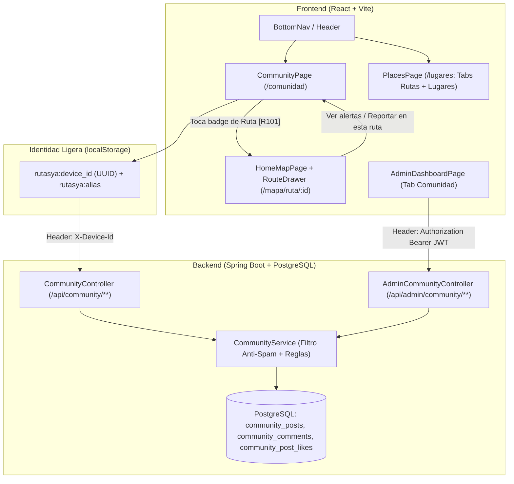

# Plan de Implementación: Menú de Comunidad Ciudadana y Unificación de Guardados

> **Proyecto:** RutaYa  
> **Estrategia Seleccionada:** Comunidad de fricción cero (Alias + `deviceId` en `localStorage`), publicaciones categorizadas vinculadas a rutas, integración bidireccional con `RouteDrawer`, moderación en Panel Admin y fusión de Favoritos dentro de `Lugares`.  
> **Estado:** Implementado

---

## 1. Resumen Ejecutivo y Decisiones de Arquitectura

El objetivo es transformar **RutaYa** de un catálogo estático a una plataforma colaborativa en tiempo real donde los ciudadanos puedan reportar alertas de tráfico/desvíos, preguntar cómo llegar a un destino, compartir recomendaciones o reportar objetos perdidos en las unidades de transporte.

### Decisiones Clave Acordadas
1. **Identidad de Fricción Cero (Alias + `deviceId`):** Los ciudadanos no necesitan crear cuenta con correo/contraseña. Al publicar o comentar por primera vez, eligen un **Alias** que se guarda en `localStorage` junto con un `deviceId` (UUID v4 autogenerado). El `deviceId` permite controlar los *"Útil / Likes"* (1 por dispositivo) y permitir que el autor elimine sus propias publicaciones o comentarios.
2. **Navegación Principal y Unificación de Favoritos:**
   * En [`BottomNav.jsx`](file:///home/anthony/Storage/dev/Projects/rutasYa/frontend/src/components/common/BottomNav.jsx) y [`Header.jsx`](file:///home/anthony/Storage/dev/Projects/rutasYa/frontend/src/components/common/Header.jsx), el ítem **Favoritos** se reemplaza por **Comunidad** (`/comunidad`), manteniendo las 5 pestañas óptimas para móvil: `Inicio`, `Mapa`, `Rutas`, `Comunidad`, `Lugares`.
   * La funcionalidad de rutas favoritas (`useFavorites.js` y corazones en tarjetas/mapa) **se conserva íntegramente** y se unifica dentro de [`PlacesPage.jsx`](file:///home/anthony/Storage/dev/Projects/rutasYa/frontend/src/pages/citizen/PlacesPage.jsx) mediante dos pestañas internas: **"Rutas Favoritas"** y **"Mis Lugares"**. La ruta `/favoritos` redirigirá automáticamente a `/lugares?tab=rutas`.
3. **Publicaciones Categorizadas + Etiquetado de Rutas:**
   * Categorías disponibles: `ALERTA` (🚨 Tráfico/Desvío/Demora), `PREGUNTA` (❓ ¿Cómo llego?), `RECOMENDACION` (💡 Consejo/Tarifa/Horario) y `OBJETOS_PERDIDOS` (🎒 Objetos extraviados).
   * Cualquier publicación puede vincularse opcionalmente a una **Ruta** del catálogo (`route_id`).
4. **Integración Bidireccional con el Mapa (`RouteDrawer.jsx`):**
   * Tocar el badge de una ruta en un post de Comunidad abre directamente su recorrido en `/mapa/ruta/:id`.
   * Al abrir una ruta en el mapa ([`RouteDrawer.jsx`](file:///home/anthony/Storage/dev/Projects/rutasYa/frontend/src/components/routes/RouteDrawer.jsx)), se muestra un resumen/banner con la última alerta o cantidad de reportes comunitarios de esa ruta y un botón directo para ver o reportar en `/comunidad?routeId=:id`.
5. **Moderación Híbrida y Anti-Spam:**
   * El backend valida longitud y filtra palabras ofensivas.
   * El autor puede borrar sus propios posts/comentarios (`X-Device-Id`).
   * El administrador dispone de una nueva pestaña **"Comunidad"** en [`AdminDashboardPage.jsx`](file:///home/anthony/Storage/dev/Projects/rutasYa/frontend/src/pages/admin/AdminDashboardPage.jsx) para supervisar y eliminar cualquier publicación o comentario.

### Flujo de Arquitectura e Interacción



---

## 2. Fase 1: Base de Datos (PostgreSQL)

> [!IMPORTANT]
> Dado que `spring.jpa.open-in-view=false` está activo en `application.properties`, las relaciones hacia `Route` y `City` deben consultarse con `LEFT JOIN FETCH` en los repositorios y respaldarse con índices en las claves foráneas.

### 2.1. Nueva Migración SQL
**Archivo a crear:** `backend/src/main/resources/db/migration/V6__add_community_tables.sql` *(o `V7` si se ejecuta después del filtrado por ciudad)*

```sql
-- Migration: Create community posts, comments, and likes tables

CREATE TABLE IF NOT EXISTS community_posts (
    id UUID PRIMARY KEY DEFAULT gen_random_uuid(),
    author_alias VARCHAR(50) NOT NULL,
    author_device_id VARCHAR(64) NOT NULL,
    category VARCHAR(30) NOT NULL, -- ALERTA, PREGUNTA, RECOMENDACION, OBJETOS_PERDIDOS
    content VARCHAR(600) NOT NULL,
    route_id UUID REFERENCES routes(id) ON DELETE SET NULL,
    city_id UUID REFERENCES cities(id) ON DELETE SET NULL,
    likes_count INTEGER NOT NULL DEFAULT 0,
    comments_count INTEGER NOT NULL DEFAULT 0,
    created_at TIMESTAMP NOT NULL DEFAULT NOW(),
    updated_at TIMESTAMP NOT NULL DEFAULT NOW()
);

CREATE TABLE IF NOT EXISTS community_comments (
    id UUID PRIMARY KEY DEFAULT gen_random_uuid(),
    post_id UUID NOT NULL REFERENCES community_posts(id) ON DELETE CASCADE,
    author_alias VARCHAR(50) NOT NULL,
    author_device_id VARCHAR(64) NOT NULL,
    content VARCHAR(400) NOT NULL,
    created_at TIMESTAMP NOT NULL DEFAULT NOW()
);

CREATE TABLE IF NOT EXISTS community_post_likes (
    id UUID PRIMARY KEY DEFAULT gen_random_uuid(),
    post_id UUID NOT NULL REFERENCES community_posts(id) ON DELETE CASCADE,
    device_id VARCHAR(64) NOT NULL,
    created_at TIMESTAMP NOT NULL DEFAULT NOW(),
    CONSTRAINT uq_community_post_like_device UNIQUE (post_id, device_id)
);

-- Índices para lectura rápida del feed y resumen por ruta
CREATE INDEX IF NOT EXISTS idx_community_posts_created_at ON community_posts (created_at DESC);
CREATE INDEX IF NOT EXISTS idx_community_posts_route_id ON community_posts (route_id, created_at DESC);
CREATE INDEX IF NOT EXISTS idx_community_posts_city_id ON community_posts (city_id, created_at DESC);
CREATE INDEX IF NOT EXISTS idx_community_posts_category ON community_posts (category, created_at DESC);
CREATE INDEX IF NOT EXISTS idx_community_comments_post_id ON community_comments (post_id, created_at ASC);
```

### 2.2. Datos Semilla (Seed Data)
**Archivo a modificar:** `backend/src/main/resources/db/seed/seed_data.sql`

Agregar 3 o 4 publicaciones iniciales realistas (ej. una alerta sobre la ruta `R101`, una consulta de paradero y una recomendación de horario) para que el feed tenga contenido demostrativo desde el primer despliegue.

---

## 3. Fase 2: Backend (Spring Boot / Java 21)

### 3.1. Entidades (`backend/src/main/java/com/anthony/rutas/entities/`)

1. **`PostCategory.java`** (Enum):
   ```java
   public enum PostCategory {
       ALERTA,
       PREGUNTA,
       RECOMENDACION,
       OBJETOS_PERDIDOS
   }
   ```
2. **`CommunityPost.java`**:
   * Campos: `id`, `authorAlias`, `authorDeviceId`, `category` (`@Enumerated(EnumType.STRING)`), `content`, `route` (`@ManyToOne(fetch = FetchType.LAZY)`), `city` (`@ManyToOne(fetch = FetchType.LAZY)`), `likesCount`, `commentsCount`, `createdAt`, `updatedAt`.
3. **`CommunityComment.java`**:
   * Campos: `id`, `post` (`@ManyToOne(fetch = FetchType.LAZY)`), `authorAlias`, `authorDeviceId`, `content`, `createdAt`.
4. **`CommunityPostLike.java`**:
   * Campos: `id`, `post` (`@ManyToOne(fetch = FetchType.LAZY)`), `deviceId`, `createdAt`.

### 3.2. DTOs de Entrada y Salida (`dtos/request` y `dtos/response`)

* **Requests:**
  * `CreateCommunityPostRequest.java`:
    * `@NotBlank @Size(min = 2, max = 40) String authorAlias`
    * `@NotNull PostCategory category`
    * `@NotBlank @Size(min = 5, max = 600) String content`
    * `UUID routeId` *(opcional)*
    * `UUID cityId` *(opcional)*
  * `CreateCommunityCommentRequest.java`:
    * `@NotBlank @Size(min = 2, max = 40) String authorAlias`
    * `@NotBlank @Size(min = 2, max = 400) String content`

* **Responses:**
  * `CommunityPostResponse.java`:
    * `UUID id`, `String authorAlias`, `PostCategory category`, `String content`, `int likesCount`, `int commentsCount`, `boolean likedByMe`, `boolean ownedByMe`, `LocalDateTime createdAt`
    * Datos de ruta vinculada (si existe): `UUID routeId`, `String routeCode`, `String routeName`, `String routeColor`
  * `CommunityCommentResponse.java`:
    * `UUID id`, `UUID postId`, `String authorAlias`, `String content`, `boolean ownedByMe`, `LocalDateTime createdAt`
  * `RouteCommunitySummaryResponse.java` *(para `RouteDrawer.jsx`)*:
    * `UUID routeId`, `long totalPostsCount`, `long activeAlertsCount`, `CommunityPostResponse latestPost`

### 3.3. Repositorios (`repositories/`)

1. **`CommunityPostRepository.java`**:
   * Consulta principal con `LEFT JOIN FETCH p.route` ordenada por `p.createdAt DESC`, permitiendo filtrar opcionalmente por `category`, `routeId` y `cityId`.
   * Consulta ligera `findByRouteIdOrderByCreatedAtDesc(UUID routeId, Pageable pageable)` y `countByRouteId(UUID routeId)` para el cajón de ruta en el mapa.
2. **`CommunityCommentRepository.java`**:
   * `List<CommunityComment> findByPostIdOrderByCreatedAtAsc(UUID postId)`
3. **`CommunityPostLikeRepository.java`**:
   * `Optional<CommunityPostLike> findByPostIdAndDeviceId(UUID postId, String deviceId)`
   * `Set<UUID> findLikedPostIdsByDeviceIdAndPostIds(String deviceId, Collection<UUID> postIds)` (para calcular `likedByMe` en lote sin consultas N+1).

### 3.4. Servicio y Moderación (`services/CommunityService.java`)

* **Filtro Anti-Spam / Palabras Ofensivas:**
  * Método interno `validateCleanText(String text)` que lanza `BadRequestException` si detecta insultos comunes o enlaces sospechosos repetidos, además de un control básico de enfriamiento (evitar que el mismo `deviceId` publique más de 1 post cada 15 segundos).
* **Propiedad por `deviceId` (`ownedByMe`):**
  * Al mapear a `CommunityPostResponse` y `CommunityCommentResponse`, compara `entity.getAuthorDeviceId().equals(requestDeviceId)` sin exponer nunca el `authorDeviceId` de otros usuarios en el JSON público.
  * El método `deleteOwnPost(UUID postId, String deviceId)` verifica que coincida el `deviceId`; si no coincide, lanza excepción `403/400`.
* **Moderación Admin:**
  * `adminDeletePost(UUID postId)` y `adminDeleteComment(UUID commentId)` eliminan cualquier registro sin restricción de `deviceId` y actualizan el contador `commentsCount` cuando corresponda.

### 3.5. Controladores y Seguridad

1. **`CommunityController.java` (`/api/community`)**:
   | Método | Endpoint | Header | Descripción |
   | :--- | :--- | :--- | :--- |
   | `GET` | `/api/community/posts` | `X-Device-Id` *(opc)* | Lista posts (filtros: `category`, `routeId`, `cityId`, `limit`). |
   | `POST` | `/api/community/posts` | `X-Device-Id` *(req)* | Crea una nueva publicación. |
   | `DELETE` | `/api/community/posts/{id}` | `X-Device-Id` *(req)* | Borra un post propio (verifica `deviceId`). |
   | `POST` | `/api/community/posts/{id}/like` | `X-Device-Id` *(req)* | Alterna el "Útil / Like" del dispositivo. |
   | `GET` | `/api/community/posts/{id}/comments` | `X-Device-Id` *(opc)* | Lista los comentarios de un post. |
   | `POST` | `/api/community/posts/{id}/comments` | `X-Device-Id` *(req)* | Agrega un comentario al post. |
   | `DELETE` | `/api/community/comments/{id}` | `X-Device-Id` *(req)* | Borra un comentario propio. |
   | `GET` | `/api/community/routes/{routeId}/summary` | `X-Device-Id` *(opc)* | Resumen de comunidad para `RouteDrawer.jsx`. |

2. **`AdminCommunityController.java` (`/api/admin/community`)**:
   * `GET /api/admin/community/posts` — Lista completa para moderación.
   * `DELETE /api/admin/community/posts/{id}` — Elimina cualquier post (y sus comentarios en cascada).
   * `DELETE /api/admin/community/comments/{id}` — Elimina cualquier comentario inapropiado.

3. **`SecurityConfig.java`**:
   **Archivo a modificar:** [`SecurityConfig.java`](file:///home/anthony/Storage/dev/Projects/rutasYa/backend/src/main/java/com/anthony/rutas/config/SecurityConfig.java)
   ```java
   .requestMatchers("/api/auth/**").permitAll()
   .requestMatchers(HttpMethod.GET, "/api/**").permitAll()
   .requestMatchers(HttpMethod.POST, "/api/stops/nearby").permitAll()
   .requestMatchers(HttpMethod.POST, "/api/routes/nearby").permitAll()
   .requestMatchers(HttpMethod.POST, "/api/community/**").permitAll()
   .requestMatchers(HttpMethod.DELETE, "/api/community/**").permitAll()
   .requestMatchers("/api/admin/**").authenticated()
   ```
   *(Y en [`CorsConfig.java`](file:///home/anthony/Storage/dev/Projects/rutasYa/backend/src/main/java/com/anthony/rutas/config/CorsConfig.java), asegurarse de que `X-Device-Id` esté permitido en `allowedHeaders`, lo cual ya se cumple si usa `*` o se añade explícitamente).*

---

## 4. Fase 3: Frontend (React / Vite)

### 4.1. Hook de Identidad Ligera (`useCommunityIdentity.js`)
**Archivo a crear:** `frontend/src/hooks/useCommunityIdentity.js`

* Gestiona dos claves en `localStorage`:
  * `rutasya:device_id`: Si no existe, genera un UUID (`crypto.randomUUID()` con fallback) de forma transparente.
  * `rutasya:community_alias`: Nombre o apodo elegido por el usuario (ej. `"Carlos Ica"`).
* Expone `{ deviceId, alias, setAlias, hasAlias }`.

### 4.2. Servicio API (`communityService.js`)
**Archivo a crear:** `frontend/src/services/communityService.js`

* Usa [`apiClient.js`](file:///home/anthony/Storage/dev/Projects/rutasYa/frontend/src/services/apiClient.js) adjuntando el header `{ 'X-Device-Id': getDeviceId() }` en todas las peticiones hacia `/community/**`.
* Incluye métodos para el ciudadano (`getPosts`, `createPost`, `deleteOwnPost`, `toggleLike`, `getComments`, `addComment`, `deleteOwnComment`, `getRouteSummary`) y para el administrador (`adminDeletePost`, `adminDeleteComment`).

### 4.3. Unificación de "Favoritos" y "Lugares" en `PlacesPage.jsx`
**Archivos a modificar:**
* [`PlacesPage.jsx`](file:///home/anthony/Storage/dev/Projects/rutasYa/frontend/src/pages/citizen/PlacesPage.jsx)
* [`AppRoutes.jsx`](file:///home/anthony/Storage/dev/Projects/rutasYa/frontend/src/routes/AppRoutes.jsx)

**Cambios en `PlacesPage.jsx`:**
1. Leer query param opcional `?tab=rutas` o `?tab=lugares` mediante `useSearchParams()`.
2. Añadir un selector de **2 pestañas (Segmented Control)** en el encabezado de la página:
   * **Rutas Favoritas (`favorites.length`)**: Renderiza las tarjetas de rutas guardadas con `useFavorites()` (exactamente la vista que hoy tiene [`FavoritesPage.jsx`](file:///home/anthony/Storage/dev/Projects/rutasYa/frontend/src/pages/citizen/FavoritesPage.jsx), permitiendo abrirlas en el mapa o quitarlas).
   * **Mis Lugares (`places.length`)**: Renderiza los paraderos/destinos guardados con `usePlaces()`.
3. En [`AppRoutes.jsx`](file:///home/anthony/Storage/dev/Projects/rutasYa/frontend/src/routes/AppRoutes.jsx), cambiar `<Route path="/favoritos" ... />` por `<Navigate to="/lugares?tab=rutas" replace />` para que cualquier enlace existente lleve directo a la pestaña de rutas favoritas.

### 4.4. Actualización de Menús de Navegación
**Archivos a modificar:**
* [`BottomNav.jsx`](file:///home/anthony/Storage/dev/Projects/rutasYa/frontend/src/components/common/BottomNav.jsx):
  * Cambiar `{ label: 'Favoritos', icon: Heart, path: '/favoritos' }` por `{ label: 'Comunidad', icon: MessageSquare, path: '/comunidad' }`.
* [`Header.jsx`](file:///home/anthony/Storage/dev/Projects/rutasYa/frontend/src/components/common/Header.jsx):
  * Cambiar `{ label: 'Favoritos', path: '/favoritos' }` por `{ label: 'Comunidad', path: '/comunidad' }`.
* [`HomePage.jsx`](file:///home/anthony/Storage/dev/Projects/rutasYa/frontend/src/pages/citizen/HomePage.jsx):
  * En la sección de `QuickActions`, podemos actualizar o añadir el acceso rápido a **Comunidad** (`/comunidad`) o mantener el de Favoritos apuntando a `/lugares?tab=rutas`.

### 4.5. Nueva Pantalla `CommunityPage.jsx`
**Archivo a crear:** `frontend/src/pages/citizen/CommunityPage.jsx`

1. **Encabezado + Botón "Publicar":**
   * Título **Comunidad**, indicador del alias actual (con botón para editarlo) y botón flotante o superior **"Nueva publicación"**.
2. **Barra de Filtros Horizontales (Chips):**
   * `Todos`, `🚨 Alertas`, `❓ ¿Cómo llego?`, `💡 Recomendaciones`, `🎒 Objetos perdidos`.
   * Si se entra con `?routeId=...`, muestra un chip activo filtrando por esa ruta con opción de limpiar el filtro (`✕ Ver todas las rutas`).
3. **Tarjetas de Publicación (`CommunityPostCard`):**
   * Avatar con iniciales del `authorAlias`, tiempo relativo (*"hace 10 min"*), badge de categoría con color semántico.
   * **Badge de Ruta vinculada** (si tiene `routeId`): muestra el código y color de la ruta (ej. `[R101] Plaza de Armas - Huacachina`) y al hacer clic ejecuta `selectRoute` + `navigate('/mapa/ruta/' + post.routeId)`.
   * Barra inferior de acciones:
     * Botón **Útil / Me gusta** (`ThumbsUp` o `Heart`) con contador animado.
     * Botón **Comentarios (`commentsCount`)** que despliega el hilo de respuestas e input para responder rápido.
     * Botón **Eliminar (`Trash2`)** visible únicamente si `post.ownedByMe === true`.
4. **Modal / Cajón de Creación de Post:**
   * Si el usuario aún no tiene `alias`, pide su nombre/apodo en el primer campo.
   * Selector de categoría (4 botones visuales).
   * Selector opcional de **Ruta relacionada** (desplegable con buscador usando `routes` de `RouteContext`).
   * Área de texto con contador de caracteres (`máx. 600`).

### 4.6. Integración Bidireccional en `RouteDrawer.jsx`
**Archivo a modificar:** [`RouteDrawer.jsx`](file:///home/anthony/Storage/dev/Projects/rutasYa/frontend/src/components/routes/RouteDrawer.jsx)

* Cuando `selectedRoute?.id` cambia, realiza una llamada ligera a `communityService.getRouteSummary(selectedRoute.id)`.
* Debajo de los datos operativos (horario/frecuencia) o de la descripción de la ruta, renderiza una tarjeta compacta de **Comunidad en esta ruta**:
  * Si hay una alerta reciente (`latestPost`), muestra un extracto de 1 línea con su ícono de categoría y hace cuánto se publicó.
  * Incluye dos botones rápidos: **"Ver comentarios ({totalPostsCount})"** y **"Reportar / Comentar"**, que navegan a `/comunidad?routeId=${selectedRoute.id}`.

### 4.7. Pestaña de Moderación en `AdminDashboardPage.jsx`
**Archivo a modificar:** [`AdminDashboardPage.jsx`](file:///home/anthony/Storage/dev/Projects/rutasYa/frontend/src/pages/admin/AdminDashboardPage.jsx)

1. Añadir `{ id: 'community', label: 'Comunidad', icon: MessageSquare }` al arreglo `TABS`.
2. Agregar el fetcher `community: () => communityService.getAdminPosts()` en `COLLECTION_FETCHERS`.
3. En la vista `activeTab === 'community'`:
   * Buscador por texto/autor y filtro por categoría.
   * Tabla/lista de publicaciones con autor, categoría, ruta vinculada, fecha, contenido y botón para expandir/eliminar comentarios individuales o eliminar la publicación completa con confirmación.

---

## 5. Manejo de Casos Borde (Edge Cases)

| Escenario | Comportamiento del Sistema |
| :--- | :--- |
| **1. Usuario borra caché / `localStorage`** | Se genera un nuevo `deviceId` automáticamente. Puede seguir leyendo y publicando sin errores; solo pierde el permiso de borrar posts antiguos creados con el `deviceId` anterior (los cuales siguen moderables por el Admin). |
| **2. Se elimina una Ruta desde el Panel Admin** | Gracias a `ON DELETE SET NULL` en `route_id`, los posts de la comunidad no se rompen ni desaparecen; simplemente dejan de mostrar el badge de ruta. |
| **3. Usuario intenta dar múltiples "Likes" al mismo post** | La restricción única `UNIQUE (post_id, device_id)` en PostgreSQL garantiza que cada dispositivo solo pueda sumar 1 voto; tocar de nuevo quita el voto (toggle). |
| **4. Usuario navega a `/favoritos` por un marcador guardado** | `AppRoutes.jsx` redirige limpiamente a `/lugares?tab=rutas`, abriendo la pestaña de Rutas Favoritas sin pérdida de datos. |

---

## 6. Orden de Ejecución Paso a Paso (Checklist)

- [x] **Paso 1 (BD):** Crear la migración `V6__add_community_tables.sql` (o `V7` según numeración activa) y añadir posts semilla en `seed_data.sql`.
- [x] **Paso 2 (Backend - Modelo y Repositorios):** Crear `PostCategory`, `CommunityPost`, `CommunityComment`, `CommunityPostLike` y sus 3 repositorios JPA.
- [x] **Paso 3 (Backend - Servicio y Controladores):** Implementar `CommunityService` (con validación anti-spam y control por `deviceId`), `CommunityController`, `AdminCommunityController` y actualizar `SecurityConfig.java` / `CorsConfig.java`.
- [x] **Paso 4 (Frontend - Guardados Unificados):** Actualizar `PlacesPage.jsx` con los tabs *"Rutas Favoritas"* y *"Mis Lugares"*, y redirigir `/favoritos` en `AppRoutes.jsx`.
- [x] **Paso 5 (Frontend - Identidad y Servicio):** Crear `useCommunityIdentity.js` y `communityService.js`.
- [x] **Paso 6 (Frontend - Comunidad y Navegación):** Crear `CommunityPage.jsx`, registrarla en `AppRoutes.jsx` y actualizar `BottomNav.jsx`, `Header.jsx` y `HomePage.jsx`.
- [x] **Paso 7 (Frontend - RouteDrawer y Admin):** Integrar el widget de resumen comunitario en `RouteDrawer.jsx` y la pestaña de moderación en `AdminDashboardPage.jsx`.
- [x] **Paso 8 (Verificación):** Compilar backend (`./mvnw test-compile`) y frontend (`pnpm run build` / `lint`) verificando todos los flujos.

